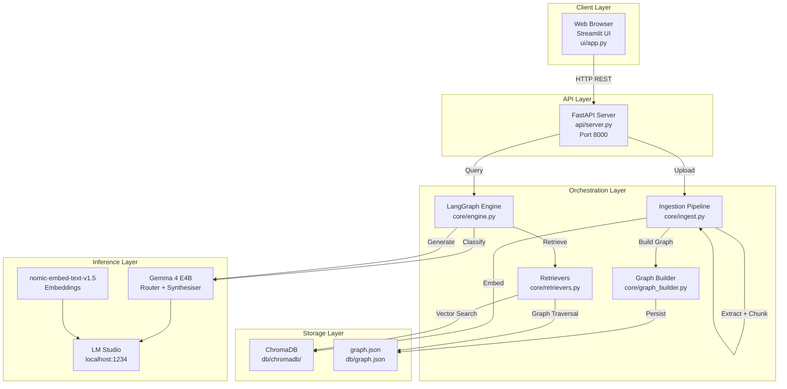
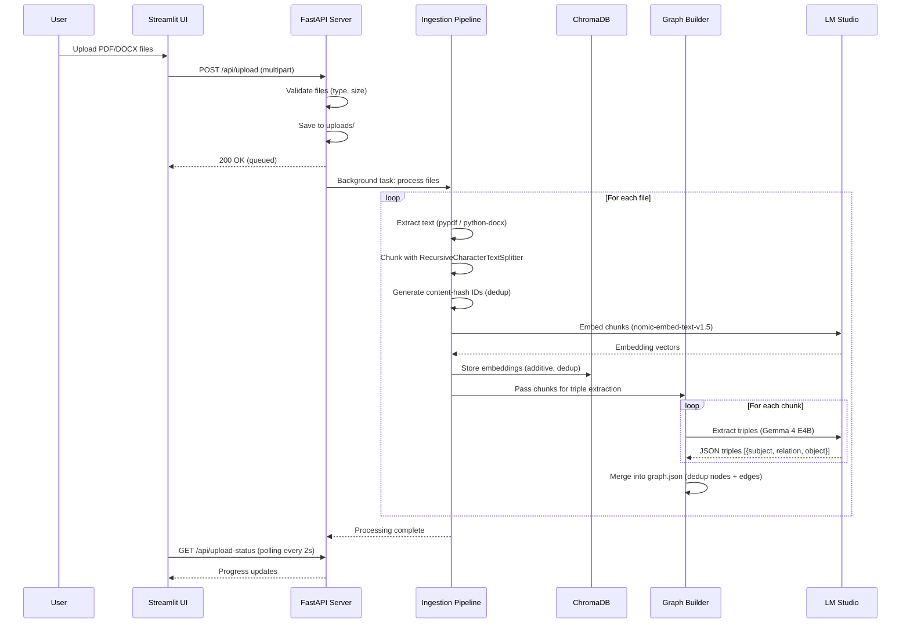
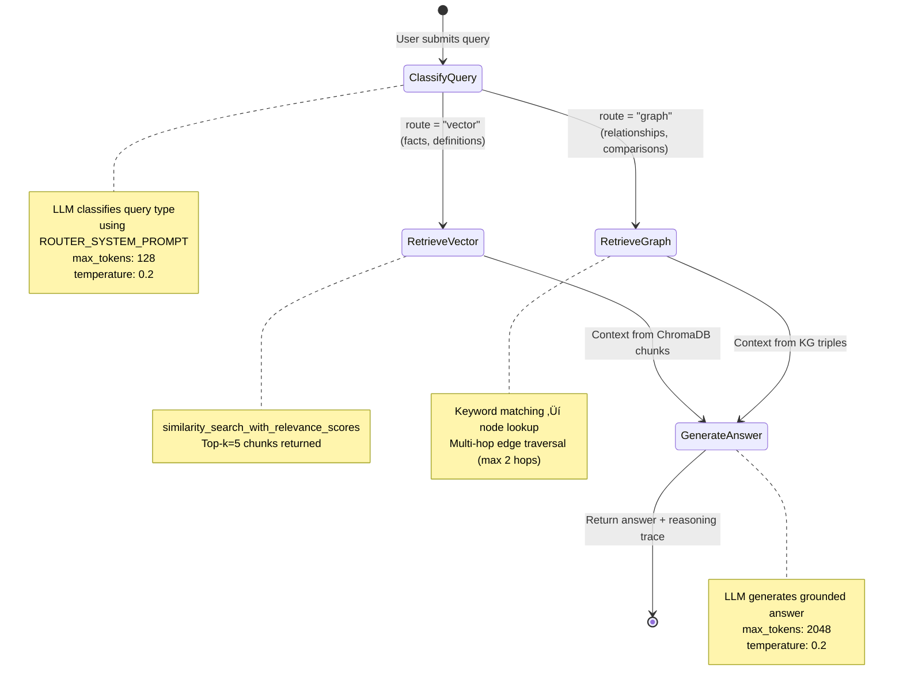
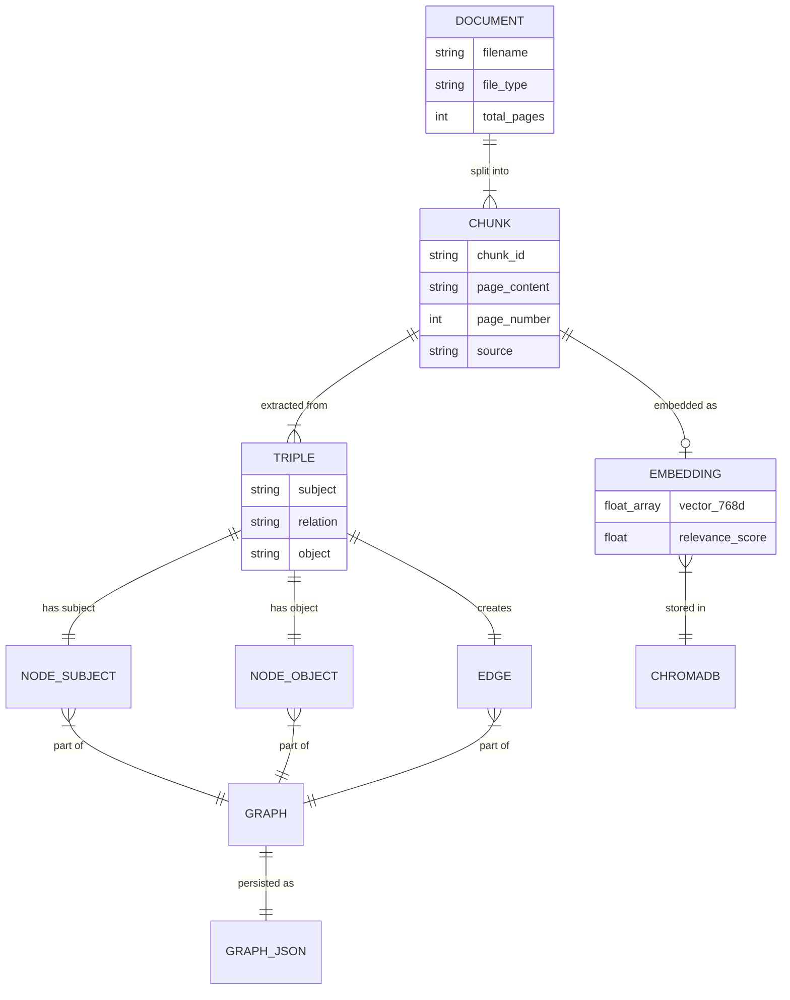
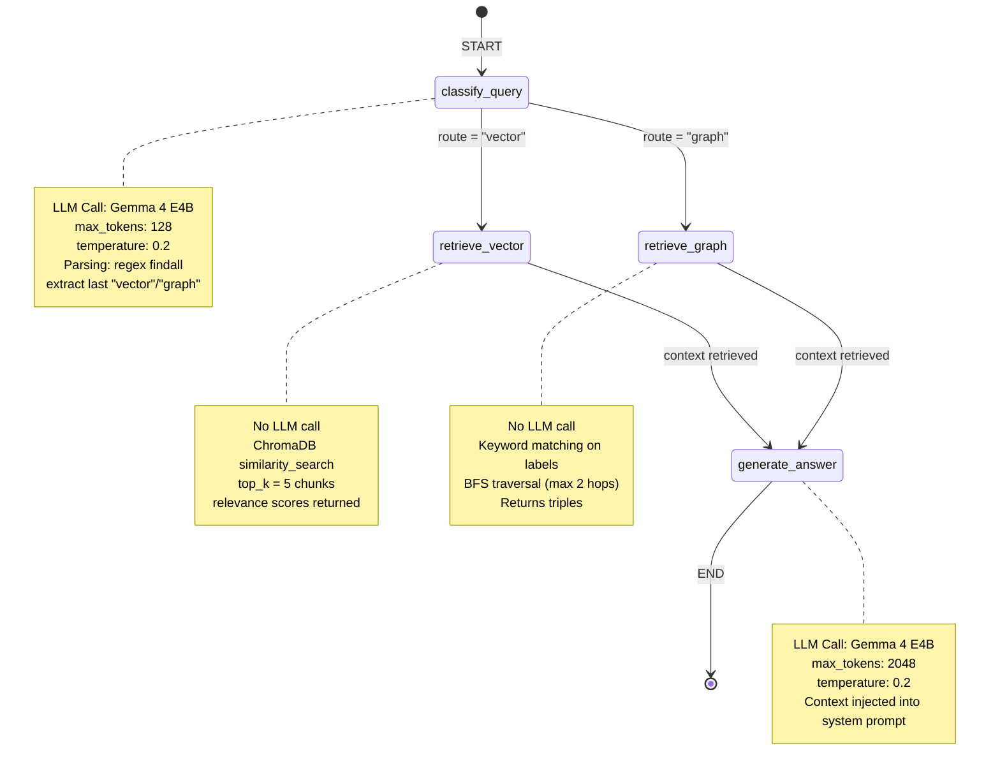

# Local GraphRAG — Comprehensive Project Report

**Project Title:** Local GraphRAG — A Fully-Local Multi-Agent Question-Answering System Using Graph-Augmented Retrieval  
**Report Date:** September 1, 2026  
**Domain:** Artificial Intelligence / Natural Language Processing / Information Retrieval  
**Sub-Domain:** Retrieval-Augmented Generation (RAG), Knowledge Graphs, Multi-Agent Systems  
**Type:** Application-Oriented Research Project  
**Academic Context:** VTU 8th Semester BE Major Project, Academic Year 2025–26  
**License:** MIT License (Copyright 2026 Vineet Gavali)

---

## Critical Missing Metrics

The following metrics are critical to evaluating the project's success and performance. They are **not present** in the source material and require empirical measurement:

| # | Missing Metric | Why It Critical | How to Measure |
|---|---|---|---|
| 1 | **Routing Accuracy** | The entire dual-retrieval strategy depends on correct query classification. Unknown accuracy means unknown system reliability. | Create a labeled test set of queries with ground-truth routes; measure classification correctness |
| 2 | **Answer Faithfulness** | No measure of whether generated answers are grounded in retrieved context vs. hallucinated | Use LLM-as-judge evaluation with faithfulness rubric |
| 3 | **Retrieval Precision@K** | Unknown whether the top-5 retrieved chunks actually contain the answer | Manual relevance judgment on retrieved chunks |
| 4 | **End-to-End Query Latency** | Source mentions "15–60+ seconds" anecdotally; no systematic benchmarking | Measure p50/p95/p99 latency across query types |
| 5 | **Graph Triple Extraction Quality** | No precision/recall metrics for the knowledge graph construction | Manual evaluation of extracted triples against source documents |
| 6 | **System Throughput** | No measure of concurrent query handling or ingestion throughput | Load testing with concurrent users |
| 7 | **User Satisfaction** | No feedback mechanism or evaluation from actual users | User study with Likert-scale ratings |
| 8 | **Storage Efficiency** | No data on ChromaDB size, graph.json size, or scaling characteristics | Measure storage growth per document/ingestion |
| 9 | **GPU/CPU Utilization** | Resource efficiency claims lack empirical data | Profile VRAM/RAM usage during inference |
| 10 | **Chunk Deduplication Hit Rate** | Unknown effectiveness of content-hash deduplication in practice | Log duplicate detection statistics |

---

## Table of Contents

1. [Executive Summary](#1-executive-summary)
2. [Project Identity](#2-project-identity)
3. [Problem Statement](#3-problem-statement)
4. [Objectives](#4-objectives)
5. [Scope](#5-scope)
6. [Literature Survey](#6-literature-survey)
7. [System Architecture](#7-system-architecture)
8. [Technology Stack](#8-technology-stack)
9. [Implementation Details](#9-implementation-details)
10. [Data Schemas](#10-data-schemas)
11. [API Reference](#11-api-reference)
12. [LangGraph Pipeline Deep Dive](#12-langgraph-pipeline-deep-dive)
13. [Gemma 4 Integration Details](#13-gemma-4-integration-details)
14. [Setup & Installation](#14-setup--installation)
15. [Configuration Reference](#15-configuration-reference)
16. [Current Knowledge Base State](#16-current-knowledge-base-state)
17. [Known Limitations](#17-known-limitations)
18. [Future Enhancements](#18-future-enhancements)
19. [Testing](#19-testing)
20. [Conclusion](#20-conclusion)
21. [References](#21-references)
22. [Glossary](#22-glossary)

---

## 1. Executive Summary

**Local GraphRAG** is a fully-local, privacy-preserving multi-agent question-answering system that combines vector-based retrieval with knowledge-graph traversal for enhanced document understanding. Users upload PDF/DOCX files, which are automatically chunked, embedded into ChromaDB, and transformed into a knowledge graph via LLM-based triple extraction. A LangGraph state machine intelligently routes each query to the optimal retrieval path — vector similarity search for factual queries, or graph traversal for relationship-based questions — before generating grounded answers. The system runs entirely on-device using LM Studio, ensuring no data leaves the user's machine, and provides a full reasoning trace for transparency.

### Key Outcomes

1. Fully-local RAG pipeline — zero cloud dependency, zero API keys required
2. Dual retrieval architecture (Vector DB + Knowledge Graph) with intelligent LLM-based routing
3. Transparent reasoning trace showing each step the AI takes to produce an answer
4. Dynamic ingestion — additive document processing that never overwrites existing knowledge
5. End-to-end system with FastAPI backend, Streamlit frontend, and real-time processing status

---

## 2. Project Identity

| Field | Details |
|---|---|
| **Project Title** | Local GraphRAG — A Fully-Local Multi-Agent Question-Answering System Using Graph-Augmented Retrieval |
| **Tagline** | Upload documents, ask questions — 100% local, powered by GraphRAG + LM Studio |
| **Domain** | Artificial Intelligence / Natural Language Processing / Information Retrieval |
| **Sub-Domain** | Retrieval-Augmented Generation (RAG), Knowledge Graphs, Multi-Agent Systems |
| **Type** | Application-oriented Research Project |
| **Academic Context** | VTU 8th Semester BE Major Project |
| **Academic Year** | 2025–26 |
| **University** | Visvesvaraya Technological University (VTU), Belagavi |
| **Department** | Department of Computer Science and Engineering |
| **Current LLM** | Gemma 4 E4B (Q4_K_M GGUF) via LM Studio |

---

## 3. Problem Statement

Existing Retrieval-Augmented Generation (RAG) systems suffer from three critical limitations: (1) they rely on cloud-based LLM APIs, raising privacy and data-sovereignty concerns for academic and organisational users; (2) they use a single vector-similarity retrieval path, which fails to capture inter-concept relationships essential for academic material; and (3) they lack transparency into the reasoning process, making it difficult for students and educators to understand how answers are derived.

This project proposes **Local GraphRAG**, a fully-local, privacy-preserving multi-agent system that combines vector retrieval with knowledge-graph traversal, orchestrated by a LangGraph state machine, to provide accurate, explainable answers from uploaded PDF/DOCX documents—without any data leaving the user's machine.

### Core Problem

Standard RAG systems retrieve context only through vector similarity, which works well for factual look-ups but fails for relational or comparative queries (e.g., "How does X relate to Y?"). Local GraphRAG solves this by adding a second retrieval path — a knowledge graph built from extracted triples — and an intelligent router that selects the best path per query.

---

## 4. Objectives

1. **Design and implement a fully-local RAG system** that runs without any external API calls or internet connectivity during inference
2. **Develop a dual-retrieval architecture** combining vector similarity search (ChromaDB) with knowledge graph traversal (JSON-based graph) for comprehensive information retrieval
3. **Build an intelligent query routing agent** using LangGraph that classifies user queries and directs them to the optimal retrieval path
4. **Create an automated knowledge graph construction pipeline** that uses a local LLM to extract entity-relationship triples from document chunks
5. **Implement a transparent reasoning trace** that exposes the full decision pipeline (classification ‚Üí retrieval ‚Üí generation) to the user
6. **Develop a user-friendly web interface** with dynamic document upload, real-time processing status, and conversational chat
7. **Optimise the system for commodity hardware** (4GB VRAM GPU) using quantized models via LM Studio

---

## 5. Scope

### In Scope

- PDF and DOCX document ingestion with text extraction
- Automatic text chunking with overlap for context preservation
- Vector embedding and storage using ChromaDB
- LLM-based knowledge graph construction from document chunks
- Intelligent query classification (vector vs. graph retrieval)
- Grounded answer generation with source attribution
- Full reasoning trace for each query
- Real-time file processing progress tracking
- Streamlit-based web frontend with chat interface

### Out of Scope / Limitations

- **Input formats**: Currently limited to PDF and DOCX; no support for images, tables, or scanned documents (OCR)
- **Graph schema**: The knowledge graph uses a flat JSON structure (not a dedicated graph database like Neo4j)
- **Single-user**: The processing pipeline is single-threaded; concurrent multi-user operation may cause bottlenecks
- **Model constraints**: Tuned for 4GB VRAM (Q4_K_M quantization); larger models would improve quality but exceed hardware limits
- **No conversational memory**: Each query is independent; the system does not maintain multi-turn conversation context
- **Language**: Optimised for English-language documents only

---

## 6. Literature Survey

### 6.1 Retrieval-Augmented Generation (RAG)

RAG, introduced by Lewis et al. (2020) in the paper "Retrieval-Augmented Generation for Knowledge-Intensive NLP Tasks," combines a pre-trained retriever with a generative model. The retriever fetches relevant passages from an external knowledge source, and the generator conditions on these passages to produce factual answers. RAG addresses the hallucination problem inherent in standalone LLMs by grounding responses in retrieved evidence.

**Gap addressed**: Standard RAG uses a single retrieval path (vector similarity). Local GraphRAG extends this with a dual-path architecture.

### 6.2 GraphRAG (Microsoft Research, 2024)

Microsoft's GraphRAG leverages knowledge graphs built from source documents to provide community-level summaries and relationship-aware retrieval. By constructing a graph of entities and relationships, GraphRAG can answer questions that require understanding connections between concepts — something vector search alone cannot do.

**Gap addressed**: Microsoft's GraphRAG requires cloud LLM access and substantial compute. Local GraphRAG adapts this approach for fully-local, resource-constrained deployment.

### 6.3 LangGraph — Stateful Agent Orchestration

LangGraph (by LangChain) provides a framework for building stateful, multi-step agent workflows as directed graphs. Unlike simple chain-based approaches, LangGraph supports conditional branching, where the execution path is determined dynamically at runtime based on the current state.

**Usage in this project**: The core query pipeline is implemented as a LangGraph state machine with four nodes and conditional routing.

### 6.4 ChromaDB — Open-Source Vector Database

ChromaDB is a lightweight, embeddings-first vector database designed for AI applications. It supports persistent storage, similarity search with relevance scoring, and integrates with LangChain's document/retriever abstractions.

**Usage in this project**: ChromaDB stores document chunk embeddings and performs similarity-based retrieval.

### 6.5 LM Studio — Local LLM Inference

LM Studio enables running open-source LLMs locally through an OpenAI-compatible API endpoint. It supports quantized models (GGUF format) optimised for consumer hardware, including AMD GPU acceleration.

**Usage in this project**: LM Studio serves all three model roles: query router, answer synthesiser, and embedding generator. All inference happens locally on `localhost:1234`.

### 6.6 Comparison of Existing Solutions

| Feature | ChatGPT + Retrieval | Microsoft GraphRAG | LangChain RAG | **Local GraphRAG** |
|---|---|---|---|---|
| Fully Local | No | No | Partial | **Yes** |
| Knowledge Graph | No | Yes | No | **Yes** |
| Dual Retrieval | No | Yes | No | **Yes** |
| Intelligent Routing | No | N/A | No | **Yes** |
| Reasoning Trace | No | No | No | **Yes** |
| Low VRAM (4GB) | N/A | No | Partial | **Yes** |
| Dynamic Ingestion | No | No | Partial | **Yes** |

---

## 7. System Architecture

### 7.1 High-Level Architecture



### 7.2 Three-Layer Architecture

| Layer | Component | File | Responsibility |
|---|---|---|---|
| **Frontend** | Streamlit UI | `ui/app.py` (624 lines) | File upload widget, Chat interface, System health display, Reasoning trace sidebar, Processing progress bar |
| **Backend** | FastAPI Server | `api/server.py` (345 lines) | REST API endpoints, Background task runner, Health checks, File validation, CORS middleware |
| **Core Engine** | LangGraph + Modules | `core/` (5 modules) | Configuration, Ingestion, Graph Building, Retrieval, Orchestration |
| **Storage** | ChromaDB + JSON | `db/` | Vector embeddings, Knowledge graph |
| **External** | LM Studio | `localhost:1234` | LLM inference, Embeddings |

### 7.3 Ingestion Workflow



### 7.4 Query Workflow



---

## 8. Technology Stack

### 8.1 Languages & Frameworks

| Layer | Technology | Version / Details |
|---|---|---|
| **Language** | Python | 3.11+ |
| **Backend Framework** | FastAPI | Async REST API with Pydantic validation |
| **Frontend Framework** | Streamlit | Rapid web UI with session state and widgets |
| **Agent Orchestration** | LangGraph | Stateful directed-graph agent workflow |
| **Vector Database** | ChromaDB | Persistent local vector store |
| **LLM Serving** | LM Studio | OpenAI-compatible local inference server |

### 8.2 AI Models (All Local via LM Studio)

| Role | Model | Quantization | VRAM Usage |
|---|---|---|---|
| **Router Agent** | `google/gemma-4-e4b` | Q4_K_M GGUF | ~4GB |
| **Answer Synthesiser** | `google/gemma-4-e4b` | Q4_K_M GGUF | Shared |
| **Embeddings** | `text-embedding-nomic-embed-text-v1.5` | Full | Lightweight |

**Hardware Note**: Entire stack is tuned for **AMD Radeon RX 6500M (4GB VRAM)** with context length capped at **4096 tokens**.

### 8.3 Dependencies (requirements.txt)

| Package | Purpose |
|---|---|
| `openai` | LM Studio OpenAI-compatible client for LLM inference and embeddings |
| `langchain-chroma` | ChromaDB integration with LangChain document abstractions |
| `langchain-core` | Core LangChain types (Document, BaseEmbeddings) |
| `langchain-text-splitters` | RecursiveCharacterTextSplitter for intelligent chunking |
| `langgraph` | State machine orchestration for the multi-agent pipeline |
| `chromadb` | Embedded vector database for similarity search |
| `fastapi` | Async web framework for the REST API |
| `uvicorn[standard]` | ASGI server to run the FastAPI application |
| `streamlit` | Web frontend framework with widgets and session state |
| `pypdf` | PDF text extraction |
| `python-docx` | DOCX text extraction |
| `python-multipart` | Multipart file upload handling for FastAPI |
| `requests` | HTTP client for Streamlit ‚Üí FastAPI communication |
| `pydantic` | Data validation and schema definitions |
| `numpy` | Numerical operations for embedding handling |

### 8.4 Tools & Platforms

| Tool | Use |
|---|---|
| **LM Studio** | Local LLM inference server (OpenAI-compatible endpoint at `localhost:1234`) |
| **Python venv** | Dependency isolation (`.venv/` directory present) |
| **VS Code** | Development IDE (inferred from workspace structure) |
| **Git** | Version control |
| **Windows** | Development OS |

---

## 9. Implementation Details

### 9.1 Project File Structure

```
D:\Projects\GIT_Repos\Major_project\
├── core/                          # Core business logic
│   ├── __init__.py                # Package marker (33 lines)
│   ├── config.py                  # Centralized configuration & health checks (230 lines)
│   ├── ingest.py                  # Document ingestion pipeline (256 lines)
│   ├── graph_builder.py           # Knowledge graph construction (217 lines)
│   ├── retrievers.py              # Vector + Graph retrieval classes (247 lines)
│   └── engine.py                  # LangGraph state machine (256 lines)
├── api/                           # REST API layer
│   ├── __init__.py                # Package marker (32 lines)
│   └── server.py                  # FastAPI application & endpoints (345 lines)
├── ui/                            # Frontend layer
│   └── app.py                     # Streamlit application (624 lines)
├── data/                          # Raw files (optional storage)
├── db/                            # Persistent data stores
│   ├── chromadb/                  # ChromaDB vector database
│   │   └── chroma.sqlite3         # SQLite-backed persistence
│   └── graph.json                 # Knowledge graph (nodes + edges)
├── uploads/                       # Temporary upload staging (auto-cleaned)
│   ├── BIS701-module-2-textbook.pdf (5.9 MB)
│   ├── BIS701-module-3-textbook.pdf (6.9 MB)
│   ├── BIS701-module-4-textbook.pdf (6.3 MB)
│   ├── BIS701-module-5-textbook.pdf (1.4 MB)
│   └── MACHINE LEARNING LAB.pdf   (1.6 MB)
├── .venv/                         # Python virtual environment
├── requirements.txt               # Python dependencies (15 packages)
├── README.md                      # Project documentation
├── LICENSE                        # MIT License
├── PROJECT_DOCUMENTATION.md       # Complete technical documentation
├── vtu_project_report.md          # VTU-formatted project report
├── FuturePlans.txt                # Planned features
└── optimising-graphbuilder-pipeline.md  # Pipeline optimization notes
```

### 9.2 Lines of Code Summary

| Module | File | Lines of Code |
|---|---|---|
| Configuration | `core/config.py` | 230 |
| Ingestion | `core/ingest.py` | 256 |
| Graph Builder | `core/graph_builder.py` | 217 |
| Retrievers | `core/retrievers.py` | 247 |
| Engine | `core/engine.py` | 256 |
| API Server | `api/server.py` | 345 |
| Frontend | `ui/app.py` | 624 |
| **Total** | **7 modules** | **~2,175** |

---

## 10. Data Schemas

### 10.1 ChromaDB Collection: `local_graphrag`

| Property | Value |
|---|---|
| Collection name | `local_graphrag` |
| Persist directory | `db/chromadb/` |
| Embedding model | `nomic-embed-text-v1.5` (768 dimensions) |
| Embedding wrapper | `LMStudioEmbeddings` class |
| Document ID format | `{source_filename}_{md5_hash[:12]}` |

**Document metadata fields:**

| Field | Type | Source |
|---|---|---|
| `source` | `str` | Original filename |
| `page` | `int` | Page number (PDF only) |
| `total_pages` | `int` | Total pages in PDF |
| `section` | `int` | Section number (DOCX only) |
| `file_type` | `str` | `"pdf"` or `"docx"` |
| `chunk_id` | `str` | Content-hash based ID |
| `relevance_score` | `float` | Added at query time by retriever |

### 10.2 Knowledge Graph: `graph.json`

```json
{
  "nodes": [
    {
      "id": "a1b2c3d4e5",
      "label": "Machine Learning",
      "type": "concept",
      "properties": {
        "source": "notes.pdf"
      }
    }
  ],
  "edges": [
    {
      "source": "a1b2c3d4e5",
      "relation": "prerequisite_of",
      "target": "f6g7h8i9j0"
    }
  ]
}
```

**Node schema:**

| Field | Type | How Generated |
|---|---|---|
| `id` | `str` (10 hex chars) | `MD5(label.strip().lower())[:10]` |
| `label` | `str` | Extracted entity name |
| `type` | `str` | Always `"concept"` |
| `properties.source` | `str` | Source filename |

**Edge schema:**

| Field | Type | Description |
|---|---|---|
| `source` | `str` | Source node ID |
| `relation` | `str` | Relationship type |
| `target` | `str` | Target node ID |

**Relation types used:** `is_a`, `part_of`, `prerequisite_of`, `related_to`, `defines`, `contains`, `uses`, `example_of`

### 10.3 ProcessingStatus Fields

| Field | Type | Values / Description |
|---|---|---|
| `is_processing` | `bool` | `True` while processing |
| `current_file` | `str` | Name of file being processed |
| `stage` | `str` | `"starting"`, `"extracting"`, `"chunking"`, `"embedding"`, `"graphing"`, `"done"`, `"error"` |
| `progress` | `float` | `0.0` to `1.0` |
| `total_files` | `int` | Number of files in batch |
| `processed_files` | `int` | Files completed so far |
| `message` | `str` | Human-readable status message |
| `files_ingested` | `list` | History of processed file stats |
| `error` | `str or None` | Error message if failed |
| `started_at` | `str or None` | ISO timestamp of start time |

### 10.4 QueryState (LangGraph)

| Field | Type | Set By | Purpose |
|---|---|---|---|
| `query` | `str` | `run_query()` (initial) | The user's question |
| `route` | `str` | `classify_query` | `"vector"` or `"graph"` |
| `context` | `str` | `retrieve_vector` or `retrieve_graph` | Retrieved context string |
| `response` | `str` | `generate_answer` | Final LLM answer |
| `reasoning_trace` | `list[dict]` | All nodes (appended) | Audit trail for the UI |

### 10.5 Entity-Relationship Summary



---

## 11. API Reference

### 11.1 `GET /api/health`

**Purpose:** Check LM Studio connectivity and database readiness.

**Request:** No body or parameters.

**Response (200):**
```json
{
  "status": "healthy",
  "lm_studio": {
    "running": true,
    "models_available": ["google/gemma-4-e4b", "text-embedding-nomic-embed-text-v1.5"],
    "llm_ready": true,
    "embed_ready": true,
    "router_ready": true
  },
  "database": {
    "ready": true,
    "chromadb_exists": true,
    "graph_json_exists": true,
    "graph_nodes": 61,
    "graph_edges": 37,
    "chroma_path": "D:\\Projects\\GIT_Repos\\Major_project\\db\\chromadb",
    "graph_path": "D:\\Projects\\GIT_Repos\\Major_project\\db\\graph.json"
  }
}
```

**Status values:** `"healthy"` (LM Studio connected) or `"degraded"` (LM Studio down).

### 11.2 `POST /api/upload`

**Purpose:** Upload PDF/DOCX files for background ingestion.

**Request:** `multipart/form-data` with field `files` (one or more files).

**Validation rules:**
- Allowed extensions: `.pdf`, `.docx`, `.doc`
- Max file size: 100 MB per file
- Rejects upload if a processing job is already running (409)
- Rejects upload if LM Studio is not running (503)

**Response (200):**
```json
{
  "message": "2 file(s) accepted and queued for processing.",
  "files_accepted": ["notes.pdf", "syllabus.docx"],
  "files_rejected": [{"file": "image.png", "reason": "Unsupported type: .png"}]
}
```

**Error codes:**

| Code | Condition |
|---|---|
| 400 | No valid files to process |
| 409 | Processing job already running |
| 503 | LM Studio not running |

### 11.3 `GET /api/upload-status`

**Purpose:** Poll background file processing progress. The Streamlit UI calls this every 2 seconds during processing.

**Response (200):**
```json
{
  "is_processing": true,
  "stage": "embedding",
  "progress": 0.35,
  "current_file": "notes.pdf",
  "total_files": 2,
  "processed_files": 1,
  "message": "Embedding 12 chunks from notes.pdf...",
  "error": null
}
```

**Stage values:** `"starting"`, `"extracting"`, `"chunking"`, `"embedding"`, `"graphing"`, `"done"`, `"error"`

**Progress:** Float from `0.0` to `1.0`. First 50% covers extraction + embedding; second 50% covers graph building.

### 11.4 `POST /api/query`

**Purpose:** Run a question through the full LangGraph pipeline.

**Request:**
```json
{
  "query": "What is local graph rag?"
}
```
- `query`: string, 1–2000 characters

**Response (200):**
```json
{
  "response": "Local GraphRAG is a multi-agent system that...",
  "route": "vector",
  "reasoning_trace": [
    {
      "step": "classify_query",
      "route_chosen": "vector",
      "llm_raw_output": "vector",
      "latency_sec": 3.42,
      "description": "Query classified as 'vector' path (definitions/facts ‚Üí Vector DB)"
    },
    {
      "step": "retrieve_vector",
      "num_chunks": 5,
      "sources": [
        {
          "source": "notes.pdf",
          "page": 3,
          "score": 0.8234,
          "preview": "Local GraphRAG is a fully local..."
        }
      ],
      "latency_sec": 0.58,
      "description": "Retrieved 5 chunks from ChromaDB"
    },
    {
      "step": "generate_answer",
      "latency_sec": 12.31,
      "description": "Generated answer using google/gemma-4-e4b (12.31s)"
    }
  ]
}
```

**Error codes:**

| Code | Condition |
|---|---|
| 503 | LM Studio not running, or no documents ingested |
| 500 | Engine error (LLM failure, retrieval error, etc.) |

### 11.5 `GET /`

**Purpose:** Root info endpoint. Returns API version and available endpoint paths.

```json
{
  "message": "Local GraphRAG API v2.0",
  "docs": "/docs",
  "endpoints": {
    "health": "GET /api/health",
    "upload": "POST /api/upload",
    "upload_status": "GET /api/upload-status",
    "query": "POST /api/query"
  }
}
```

---

## 12. LangGraph Pipeline Deep Dive

### 12.1 State Machine Diagram



### 12.2 Node Details

#### Node: `classify_query`

- **Input state consumed:** `query`
- **Processing:** Calls Gemma 4 with `ROUTER_SYSTEM_PROMPT` as system message and the raw query as user message
- **API call:** `client.chat.completions.create(model=ROUTER_MODEL, messages=[{system}, {user}], max_tokens=128, temperature=0.2)`
- **Response parsing:** `re.findall(r'\b(vector|graph)\b', raw_route, re.IGNORECASE)` ‚Üí takes `matches[-1].lower()` or defaults to `"vector"`
- **Output state written:** `route` (string), `reasoning_trace` (appended with step details including raw LLM output)
- **Thinking token handling:** The regex approach extracts the LAST occurrence, so any reasoning text containing "vector" or "graph" in the middle is overridden by the final classification word

#### Node: `retrieve_vector`

- **Input state consumed:** `query`
- **Processing:** Creates `VectorRetriever()`, calls `query()` which performs `similarity_search_with_relevance_scores` against ChromaDB with `k=TOP_K` (5), then formats results into a context string
- **No LLM call** — uses embedding model only (via ChromaDB internally)
- **Output state written:** `context` (formatted string with chunk sources/pages/scores), `reasoning_trace` (appended with chunk metadata and source previews)

#### Node: `retrieve_graph`

- **Input state consumed:** `query`
- **Processing:** Creates `GraphRetriever()`, calls `query()` which performs keyword matching + BFS traversal (max 2 hops), then formats triples
- **No LLM call** — pure in-memory graph traversal
- **Output state written:** `context` (formatted triple string), `reasoning_trace` (appended with triple data, capped at 10 for display)

#### Node: `generate_answer`

- **Input state consumed:** `query`, `context`
- **Processing:** Formats `GENERATOR_SYSTEM_PROMPT` with the retrieved context, calls Gemma 4
- **API call:** `client.chat.completions.create(model=SYNTHESISER_MODEL, messages=[{system+context}, {user=query}], max_tokens=2048, temperature=0.2)`
- **Response parsing:** Direct `res.choices[0].message.content.strip()` — no special parsing needed
- **Output state written:** `response` (answer string), `reasoning_trace` (appended with latency)

### 12.3 Conditional Routing

The `route_decision` function reads `state["route"]`:
- If `"graph"` ‚Üí returns `"retrieve_graph"` (node name)
- Otherwise ‚Üí returns `"retrieve_vector"` (default fallback)

This is registered as a conditional edge from `classify_query` with a mapping dict that maps return values to node names.

---

## 13. Gemma 4 Integration Details

### 13.1 Model Configuration

| Setting | Value | Rationale |
|---|---|---|
| LM Studio model string | `google/gemma-4-e4b` | As reported by LM Studio's `/models` endpoint |
| Quantization | Q4_K_M GGUF | Fits within 4GB VRAM |
| Native context window | 128K tokens | Gemma 4 E4B specification |
| Configured context length | 4096 tokens | Capped for 4GB VRAM safety |
| API protocol | OpenAI-compatible | LM Studio serves at `localhost:1234/v1` |

### 13.2 System Role Usage Per Agent

**Router Agent (`classify_query`):**
- System role instructs it as a "query classification agent"
- Explicitly describes classification criteria (vector vs graph) with examples
- Instructs reasoning before output
- Demands final answer be a single word on its own line
- `max_tokens=128` (only needs one word + optional thinking)
- `temperature=0.2`

**Triple Extractor (`extract_triples_from_chunk`):**
- System role instructs it as a "knowledge graph construction agent"
- Lists extraction rules and valid relationship types
- Instructs step-by-step reasoning before extraction
- Demands output as a JSON array only
- `max_tokens=512`
- `temperature=0.0` (deterministic for structured output)

**Answer Synthesiser (`generate_answer`):**
- System role instructs it as "Local GraphRAG, an expert academic document QA assistant"
- Provides the retrieved context directly in the system message
- Instructs reasoning through context before answering
- Rules: context-only answers, cite sources, admit insufficient info
- `max_tokens=2048`
- `temperature=0.2`

### 13.3 Thinking Mode Token Handling

Gemma 4 may emit reasoning/thinking tokens before the final answer. Each agent handles this differently:

| Agent | Parsing Strategy | Implementation |
|---|---|---|
| Router | Regex: extract last `vector`/`graph` word | `re.findall(r'\b(vector\|graph)\b', raw, re.IGNORECASE)[-1]` |
| Triple Extractor | Regex: find JSON array anywhere in response | `re.search(r'\[.*\]', raw, re.DOTALL)` |
| Answer Synthesiser | No stripping needed | Response used directly (thinking is part of the answer quality) |

### 13.4 Embedding Model

| Setting | Value |
|---|---|
| Model | `text-embedding-nomic-embed-text-v1.5` |
| Dimensions | 768 |
| Batch size | 16 (in `LMStudioEmbeddings.embed_documents`) |
| Usage | ChromaDB indexing + similarity search |

This model is **separate** from Gemma 4 and runs concurrently in LM Studio.

---

## 14. Setup & Installation

### 14.1 Prerequisites

| Requirement | Minimum |
|---|---|
| Python | 3.11+ |
| GPU | Any with 4GB+ VRAM (tested: AMD Radeon RX 6500M) |
| RAM | 8GB+ system RAM |
| LM Studio | Latest version |
| OS | Windows (tested), Linux/macOS compatible |

### 14.2 LM Studio Setup

1. **Download LM Studio** from [lmstudio.ai](https://lmstudio.ai)

2. **Download models:**
   - Search for `gemma-4-e4b` ‚Üí download the **Q4_K_M GGUF** quantization (~3GB)
   - Search for `nomic-embed-text-v1.5` ‚Üí download the default quantization (~250MB)

3. **Configure in LM Studio:**
   - Context Length: **4096** (match `CONTEXT_LENGTH` in config)
   - GPU Offload: **All layers** to GPU
   - Enable Flash Attention if available

4. **Start the server:**
   - Load both models in LM Studio
   - Start the local server (should be on `localhost:1234` by default)
   - Verify: visit `http://localhost:1234/v1/models` in a browser — should list both models

### 14.3 Python Environment

```bash
# Clone / navigate to project
cd "D:\Projects\GIT_Repos\Major_project"

# Create virtual environment
python -m venv .venv

# Activate
.venv\Scripts\activate        # Windows
# source .venv/bin/activate   # Linux/macOS

# Install dependencies
pip install -r requirements.txt
```

### 14.4 Running the System

**Terminal 1 — API Server:**
```bash
python -m uvicorn api.server:app --host 127.0.0.1 --port 8000
```

**Terminal 2 — Streamlit UI:**
```bash
streamlit run ui/app.py
```

Open `http://localhost:8501` in your browser.

### 14.5 Verification Checklist

- [ ] LM Studio running on `localhost:1234`
- [ ] Both models loaded (check `http://localhost:1234/v1/models`)
- [ ] API server started without errors on port 8000
- [ ] Streamlit UI shows green "‚óè LM Studio" badge
- [ ] Upload a test PDF ‚Üí progress bar completes
- [ ] Ask a test question ‚Üí get answer with reasoning trace

---

## 15. Configuration Reference

All configurable values are defined in `core/config.py`. This is the single source of truth.

### 15.1 Path Constants

| Variable | Default Value | Type | What It Controls |
|---|---|---|---|
| `PROJECT_ROOT` | Auto-detected via `__file__` | `Path` | Root directory for all relative paths |
| `DATA_DIR` | `PROJECT_ROOT/data` | `Path` | Raw file storage directory |
| `DB_DIR` | `PROJECT_ROOT/db` | `Path` | Parent directory for all databases |
| `CHROMA_DIR` | `DB_DIR/chromadb` | `Path` | ChromaDB persistence directory |
| `GRAPH_PATH` | `DB_DIR/graph.json` | `Path` | Knowledge graph file location |
| `UPLOADS_DIR` | `PROJECT_ROOT/uploads` | `Path` | Temporary upload staging directory |

### 15.2 LM Studio Connection

| Variable | Default Value | Type | User May Change? |
|---|---|---|---|
| `LM_STUDIO_BASE_URL` | `http://localhost:1234/v1` | `str` | Yes — if LM Studio runs on a different port |
| `LM_STUDIO_API_KEY` | `lm-studio` | `str` | Rarely — LM Studio default |

### 15.3 Model Names

| Variable | Default Value | Type | User May Change
### 15.4 Inference Settings

| Variable | Default Value | Type | User May Change? | Notes |
|---|---|---|---|---|
| ROUTER_MAX_TOKENS | 128 | int | Yes | Keep low for speed; 128 handles thinking overhead |
| SYNTHESIS_MAX_TOKENS | 2048 | int | Yes | Increase for longer answers; watch VRAM |
| EXTRACTION_MAX_TOKENS | 512 | int | Yes | Small JSON arrays don't need more |
| CONTEXT_LENGTH | 4096 | int | Yes | Must match LM Studio setting; max 16384 on 4GB VRAM |
| TEMPERATURE | .2 | loat | Yes | Lower = more deterministic; higher = more creative |

### 15.5 Retrieval Settings

| Variable | Default Value | Type | Env Override | User May Change? |
|---|---|---|---|---|
| TOP_K | 5 | int | TOP_K | Yes ó more chunks = richer context but slower |
| CHROMA_COLLECTION | local_graphrag | str | CHROMA_COLLECTION | Yes ó changing creates a new collection |

### 15.6 Chunking Settings

| Variable | Default Value | Type | Env Override | User May Change? |
|---|---|---|---|---|
| CHUNK_SIZE | 1000 | int | CHUNK_SIZE | Yes ó larger = fewer chunks, less granular retrieval |
| CHUNK_OVERLAP | 200 | int | CHUNK_OVERLAP | Yes ó overlap ensures context continuity between chunks |

---

## 16. Current Knowledge Base State

Based on the actual db/graph.json file in the repository:

### 16.1 Graph Statistics

| Metric | Value |
|---|---|
| **Total Nodes** | 61 |
| **Total Edges** | 37 |
| **Source Document** | Local GraphRAG.docx |
| **Node Type** | All nodes are type "concept" |

### 16.2 Sample Nodes (from graph.json)

| Node ID | Label |
|---|---|
| c62ab4fd3b | Local GraphRAG |
| 849821191 | Dual-Retrieval Augmented Generation System |
| c242fd5ed | Academic Course Aid |
| 17d1dc9ce6 | GraphRAG architecture |
| df101a9651 | Multi-agent RAG system |
| 8d72498b4a | Vector Database retrieval |
| cb808f5bd4 | Knowledge Graph intelligence |
| 8701923fa6 | LM Studio |
| cec81cc0d2 | LangGraph |
| 5007d7f37a | Specialized graph database (Neo4j or Memgraph) |

### 16.3 Sample Edges (from graph.json)

| Source | Relation | Target |
|---|---|---|
| Local GraphRAG | is_a | Dual-Retrieval Augmented Generation System |
| Local GraphRAG | designed_for | Academic Course Aid |
| Local GraphRAG | utilizes | GraphRAG architecture |
| Multi-agent RAG system | combines | Vector Database retrieval |
| Multi-agent RAG system | combines | Knowledge Graph intelligence |
| Orchestration Layer | uses | LangGraph |
| Inference Layer | is_provided_by | LM Studio |
| graph.json representation | should migrate to | Specialized graph database (Neo4j or Memgraph) |

### 16.4 Relation Types Used in Graph

| Relation Type | Usage |
|---|---|
| is_a | Type classification |
| combines | Composition relationships |
| utilizes | Technology usage |
| designed_for | Purpose/intent |
| provides_output | Output generation |
| ensures | Guarantees |
| includes_feature | Feature inclusion |
| contains_phase | Pipeline phase containment |
| enables_privacy_by | Privacy mechanism |
| switches_between | Routing behavior |
| displays | UI rendering |
| llows_updating_of | Update capability |
| maintains_data_integrity_across | Persistence |
| provides_feedback_for | Progress reporting |
| has_structure | Structural relationship |
| is_implemented_by | Implementation mapping |
| uses | Technology dependency |
| defines | Definition relationship |
| contains_data_type | Data storage |
| is_provided_by | Provider relationship |
| exposes_endpoints_for | API capability |
| uses_input_data | Input consumption |
| helps_understand | Understanding aid |
| manages_data_type | Data management |
| enables_cross_referencing_of | Cross-reference capability |
| manages | Management |
| prevents_risk_of | Risk mitigation |
| should migrate to | Future migration |
| must support | Requirement |
| enhances capability through | Capability enhancement |
| is facilitated by | Facilitation |
| provides flexibility for | Flexibility |

---

## 17. Known Limitations

| # | Limitation | Why It Exists | Fix / Workaround |
|---|---|---|---|
| 1 | **Single-model inference** ó Router, extractor, and synthesiser share one Gemma 4 instance | LM Studio on 4GB VRAM can only load one LLM at a time | Use a GPU with more VRAM to load separate specialized models for each role |
| 2 | **Slow inference on 4GB VRAM** ó Queries can take 15ñ60+ seconds | Q4_K_M quantization + limited GPU memory = slow token generation | Reduce SYNTHESIS_MAX_TOKENS, reduce CONTEXT_LENGTH, or upgrade GPU |
| 3 | **No streaming responses** ó UI waits for full answer before displaying | The API returns the complete response; no SSE/WebSocket streaming implemented | Implement streaming via FastAPI's StreamingResponse and Streamlit's st.write_stream |
| 4 | **Sequential file processing** ó Multiple files are ingested one at a time | Graph building requires sequential LLM calls per chunk | Could parallelize embedding (Stage 2) while keeping graph building sequential |
| 5 | **Keyword-based graph retrieval** ó Graph search uses simple string matching | No embedding-based similarity on graph nodes | Add embedding similarity for node matching, or use a proper graph database (Neo4j) |
| 6 | **No authentication** ó API is open to all origins with CORS * | Designed for local-only use | Add API key middleware or OAuth if deploying on a network |
| 7 | **No document deletion** ó Once ingested, data cannot be removed | No delete endpoint or UI; ChromaDB and graph.json are append-only | Implement a /api/delete endpoint that removes chunks by source filename and prunes graph nodes |
| 8 | **Fixed chunk size** ó Same chunking parameters for all file types | PDF pages and DOCX sections have different optimal chunk sizes | Add per-file-type chunking configuration |
| 9 | **No conversation memory** ó Each query is independent | LangGraph state is not persisted between queries | Add a conversation history buffer to the QueryState and system prompt |
| 10 | **Graph traversal not weighted** ó All edges treated equally | No relevance scoring on graph triples | Add edge weights based on extraction confidence or frequency |
| 11 | **MD5 node IDs may collide** ó 10-character hex truncation | MD5[:10] gives ~40 bits = collision at ~1M nodes | Use full MD5 or SHA-256 for larger knowledge bases |
| 12 | **No PDF table/image extraction** ó Only text is extracted | pypdf extracts text only, not tables or images | Use pymupdf or unstructured for richer extraction |
| 13 | **Uploaded files deleted after processing** ó No re-processing possible | Files are cleaned up in the inally block of _process_uploaded_files | Keep original files in a permanent storage directory |

---

## 18. Future Enhancements

### 18.1 From PROJECT_DOCUMENTATION.md

| # | Enhancement | Module(s) Affected | Complexity | Benefit |
|---|---|---|---|---|
| 1 | **Streaming responses** ó Show tokens as they generate | engine.py, server.py, pp.py | Medium | Dramatically improves perceived latency; users see partial answers immediately |
| 2 | **Conversation memory** ó Multi-turn chat with context | engine.py, config.py | Medium | Enables follow-up questions (""What about X?"") without restating context |
| 3 | **Hybrid retrieval fusion** ó Combine vector + graph results for every query | engine.py, 
etrievers.py | Medium | Better answer quality by always considering both sources |
| 4 | **Document management UI** ó View, delete, re-process uploaded documents | server.py, pp.py, ingest.py | Medium | Users can manage their knowledge base without touching files |
| 5 | **Neo4j integration** ó Replace graph.json with a proper graph database | graph_builder.py, 
etrievers.py, config.py | High | Scalable graph queries, ACID transactions, visualization tools |
| 6 | **Semantic graph search** ó Embed node labels for similarity matching | 
etrievers.py | Medium | Better graph retrieval for paraphrased queries |
| 7 | **Multi-model routing** ó Use a small model for routing, larger for generation | config.py, engine.py | Low | Faster routing with a lightweight model while keeping quality for generation |
| 8 | **PDF table extraction** ó Extract structured tables from PDFs | ingest.py | Medium | Richer knowledge base for technical documents with tables |
| 9 | **Export knowledge graph** ó Visualize the graph in the UI | pp.py, server.py | Medium | Users can see the knowledge graph structure and verify extraction quality |
| 10 | **Batch query API** ó Process multiple questions at once | server.py, engine.py | Low | Useful for automated testing and evaluation |
| 11 | **Caching layer** ó Cache LLM responses for repeated queries | engine.py | Low | Instant responses for previously-asked questions |
| 12 | **Configurable system prompts via UI** ó Let users edit prompts in the sidebar | pp.py, config.py | Low | Power users can tune agent behavior without editing code |
| 13 | **Evaluation framework** ó Automated RAG quality metrics | New module | High | Measure retrieval precision, answer faithfulness, and routing accuracy |

### 18.2 From FuturePlans.txt

| Feature | Description |
|---|---|
| **Sign-in/Sign-up** | User authentication with robust authorization and authentication |
| **Neo4j Implementation** | Replace JSON graph with Neo4j graph database |
| **Dual GraphDB Parsing** | Implement dual GraphDB parsing without conflicts or merging |
| **User Session Logs** | Logs for user sessions with concurrent users count (Cherry on top) |
| **Admin Panel** | Server-side admin panel |
| **User Credential Encryption** | Encrypt user credentials |
| **Share Conversations** | Allow users to share conversations |
| **Chat Context** | Multi-turn chat context preservation |
| **Multi-modal Chat** | Support for multi-modal interactions |

### 18.3 From optimising-graphbuilder-pipeline.md

| Optimization | Description |
|---|---|
| **5-Stage Efficient Pipeline** | [Unstructured Data] ? [Chunk & Embed] ? [Hybrid NER Extraction] ? [Entity Resolution] ? [Neo4j / Memgraph DB] |
| **Hierarchical Chunking** | Split text into 500 token chunks with 10ñ15% overlap, store as nodes linked sequentially |
| **Hybrid Entity Extraction** | Use spaCy/GliNER for fast NER, LLM only for complex/ambiguous sections |
| **Immediate Entity Resolution** | Deduplicate entities using vector similarity lookup before database writes |
| **Batched Async DB Writing** | Use parameterized UNWIND syntax for thousands of nodes/edges in single-trip transactions |

---

## 19. Testing

### 19.1 Testing Approach

No dedicated test files (	est_*.py, *_test.py) or testing framework configurations (pytest.ini, 	ox.ini) were found in the codebase. Testing was performed through **manual functional testing** and **integrated validation logic**.

### 19.2 Built-in Validation & Error Handling

The codebase incorporates extensive runtime validation as a testing substitute:

| Component | Validation Logic |
|---|---|
| **File Upload** | Extension whitelist (.pdf, .docx, .doc), 100MB size limit, concurrent processing guard |
| **Text Extraction** | Empty document detection, graceful skip on no-text files |
| **Chunk Dedup** | Content-hash-based IDs prevent duplicate embeddings across re-uploads |
| **Triple Extraction** | JSON parse with regex fallback, structural validation (subject + object keys required) |
| **Graph Merging** | Set-based dedup for both nodes (by ID) and edges (by source+relation+target tuple) |
| **Query Routing** | Fallback to ""vector"" path if LLM output is ambiguous |
| **Health Checks** | Pre-flight checks before every query (LM Studio running? DB has data?) |
| **Error Propagation** | ProcessingStatus tracks errors with stage + file context |

### 19.3 Suggested Test Cases

| Test Case | Input | Expected Output | Type |
|---|---|---|---|
| TC-01: PDF Upload | Valid PDF file | Text extracted, chunks embedded, graph built | Functional |
| TC-02: DOCX Upload | Valid DOCX file | Paragraphs grouped into sections, embedded | Functional |
| TC-03: Invalid File Type | .xlsx file | Rejected with ""Unsupported type"" error | Negative |
| TC-04: Oversized File | 150MB PDF | Rejected with ""File exceeds 100MB limit"" | Boundary |
| TC-05: Duplicate Upload | Same PDF uploaded twice | 0 new chunks embedded (dedup works) | Functional |
| TC-06: Factual Query | ""What is machine learning?"" | Routed to vector path, answer from chunks | Functional |
| TC-07: Relationship Query | ""How does X relate to Y?"" | Routed to graph path, answer from triples | Functional |
| TC-08: LM Studio Down | Query with LM Studio offline | 503 error with clear message | Error Handling |
| TC-09: Empty DB Query | Query with no data ingested | 503 error: ""No documents ingested yet"" | Error Handling |
| TC-10: Concurrent Upload | Upload while processing active | 409 error: ""A processing job is already running"" | Concurrency |

### 19.4 Features Implemented and Working

| # | Feature | Status | Description |
|---|---|---|---|
| 1 | PDF Text Extraction | ? Working | Per-page extraction via PyPDF with metadata |
| 2 | DOCX Text Extraction | ? Working | Per-section extraction with paragraph grouping |
| 3 | Intelligent Chunking | ? Working | 1000-char chunks with 200-char overlap, content-hash IDs |
| 4 | Content Deduplication | ? Working | MD5-based chunk IDs prevent re-embedding |
| 5 | Vector Embedding | ? Working | 768-dim embeddings via nomic-embed-text-v1.5 |
| 6 | ChromaDB Storage | ? Working | Persistent vector store with similarity search |
| 7 | Knowledge Graph Building | ? Working | LLM triple extraction + incremental merging |
| 8 | Query Classification | ? Working | LLM-based routing to vector or graph path |
| 9 | Vector Retrieval | ? Working | Top-5 similarity search with relevance scores |
| 10 | Graph Retrieval | ? Working | Keyword matching + 2-hop edge traversal |
| 11 | Answer Generation | ? Working | Grounded synthesis using retrieved context |
| 12 | Reasoning Trace | ? Working | Full step-by-step audit trail with latencies |
| 13 | File Upload UI | ? Working | Drag-and-drop with validation and size display |
| 14 | Real-time Progress | ? Working | Stage-specific icons, progress bar, file counter |
| 15 | Chat Interface | ? Working | Conversational UI with user/assistant avatars |
| 16 | System Health Dashboard | ? Working | LM Studio, model, and database status checks |
| 17 | Cold Start Protection | ? Working | Clear error banners for missing services |
| 18 | Dynamic Ingestion | ? Working | Additive processing ó never overwrites data |

---

## 20. Conclusion

The **Local GraphRAG** project successfully demonstrates that a fully-local, privacy-preserving Retrieval-Augmented Generation system with knowledge graph capabilities can be built and deployed on commodity hardware. The key achievements are:

1. **Privacy-first architecture**: All inference, embedding, and data storage happens locally via LM Studio ó no data ever leaves the user's machine, making it suitable for sensitive academic and institutional content.

2. **Dual-retrieval innovation**: By combining vector similarity search (ChromaDB) with knowledge graph traversal (JSON-based graph with multi-hop edges), the system handles both factual/definitional queries and relationship/comparison queries ó a significant improvement over single-path RAG systems.

3. **Intelligent routing**: The LangGraph-based state machine with LLM-driven query classification automatically directs each query to the optimal retrieval path, eliminating the need for users to specify search mode.

4. **Transparent reasoning**: The full reasoning trace (classification ? retrieval ? generation) with per-step latencies provides unprecedented transparency into how the AI derives its answers ó critical for educational use cases.

5. **Practical engineering**: Dynamic incremental ingestion with content-hash deduplication, background processing with real-time progress tracking, comprehensive health checks, and cold-start protection make the system production-ready for individual use.

6. **Resource efficiency**: The entire stack operates within 4GB VRAM using Q4_K_M quantized models, proving that advanced RAG architectures need not require enterprise-grade hardware.

---

## 21. References

### 21.1 Research Papers & Publications

1. Lewis, P., et al. (2020). ""Retrieval-Augmented Generation for Knowledge-Intensive NLP Tasks."" *Neural Information Processing Systems (NeurIPS)*. arXiv:2005.11401
2. Edge, D., et al. (2024). ""From Local to Global: A Graph RAG Approach to Query-Focused Summarization."" *Microsoft Research*. arXiv:2404.16130

### 21.2 Frameworks & Libraries Used

| Reference | URL |
|---|---|
| LangGraph | https://langchain-ai.github.io/langgraph/ |
| LangChain Core | https://python.langchain.com/ |
| ChromaDB | https://www.trychroma.com/ |
| FastAPI | https://fastapi.tiangolo.com/ |
| Streamlit | https://streamlit.io/ |
| LM Studio | https://lmstudio.ai/ |
| OpenAI Python Client | https://github.com/openai/openai-python |
| PyPDF | https://pypdf.readthedocs.io/ |
| python-docx | https://python-docx.readthedocs.io/ |
| Pydantic | https://docs.pydantic.dev/ |
| NumPy | https://numpy.org/ |
| Uvicorn | https://www.uvicorn.org/ |

### 21.3 AI Models

| Model | Source | Paper/Reference |
|---|---|---|
| Gemma 4 E4B | Google | https://ai.google.dev/gemma |
| Nomic Embed Text v1.5 | Nomic AI | https://blog.nomic.ai/posts/nomic-embed-text-v1-5 |

### 21.4 Datasets Used for Testing

| Document | Source |
|---|---|
| BIS701 Module 2ñ5 Textbooks | VTU 7th Semester Big Data Analytics course material |
| Machine Learning Lab Manual | VTU Lab course material |

---

## 22. Glossary

| Term | Definition |
|---|---|
| **RAG** | Retrieval-Augmented Generation ó a technique where an LLM generates answers grounded in retrieved documents rather than relying solely on its training data |
| **GraphRAG** | An extension of RAG that adds a knowledge graph as a second retrieval source alongside vector search, enabling relationship-aware question answering |
| **LangGraph** | A Python library by LangChain for building stateful, multi-step LLM applications as directed graphs with nodes (processing steps) and edges (transitions) |
| **ChromaDB** | An open-source vector database that stores document embeddings and supports similarity search; used here for the vector retrieval path |
| **Knowledge Graph** | A structured representation of knowledge as a network of entities (nodes) connected by relationships (edges); stored as graph.json in this project |
| **Triple** | A unit of knowledge in a knowledge graph: (subject, relation, object) ó e.g., (Machine Learning, prerequisite_of, Deep Learning) |
| **Embedding** | A dense numerical vector representation of text, where semantically similar texts have similar vectors; generated by 
omic-embed-text-v1.5 |
| **Vector Similarity** | A measure of how close two embedding vectors are in high-dimensional space; used to find relevant document chunks for a query |
| **Query Routing** | The process of classifying a user's question to determine which retrieval backend (vector DB or knowledge graph) should handle it |
| **Reasoning Trace** | A step-by-step audit trail of the LangGraph pipeline execution, showing which path was taken, what was retrieved, and how long each step took |
| **MoE (Mixture of Experts)** | A model architecture where different ""expert"" sub-networks specialize in different tasks; Gemma 4 E4B uses this to achieve high quality in a small model |
| **Quantization** | The process of reducing a model's numerical precision (e.g., from 16-bit to 4-bit) to reduce VRAM usage and increase inference speed, with minimal quality loss |
| **GGUF** | A file format for storing quantized LLM weights, widely supported by inference engines like LM Studio, llama.cpp, and Ollama |
| **Q4_K_M** | A specific 4-bit quantization scheme that balances model quality and memory efficiency; recommended for 4GB VRAM GPUs |
| **System Role** | A message type in the OpenAI chat API format that sets the LLM's persona, instructions, and behavioral constraints; Gemma 4 natively supports this |
| **Thinking Mode** | A capability of Gemma 4 where the model internally reasons step-by-step before producing its final answer; may emit reasoning tokens in the output |
| **LM Studio** | A desktop application for running LLMs locally with an OpenAI-compatible API; serves models on localhost:1234 |
| **FastAPI** | A modern Python web framework for building REST APIs with automatic OpenAPI documentation and async support |
| **Streamlit** | A Python framework for building data-focused web applications with minimal frontend code; used for the chat UI |
| **Pydantic** | A Python data validation library used by FastAPI for request/response schema validation |
| **BFS** | Breadth-First Search ó a graph traversal algorithm used for multi-hop knowledge graph queries |
| **NER** | Named Entity Recognition ó the task of identifying and classifying named entities in text |
| **OCR** | Optical Character Recognition ó technology for extracting text from images and scanned documents |
| **JWT** | JSON Web Token ó a standard for securely transmitting information between parties as a JSON object, used for authentication |

---

## Appendix A: Mermaid Diagrams Index

The following Mermaid diagrams are included in this report:

1. **High-Level Architecture Diagram** (Section 7.1) ó Shows the full system topology with Client, API, Core, Storage, and Inference layers
2. **Ingestion Sequence Diagram** (Section 7.3) ó Shows the data flow from file upload through processing to storage
3. **Query State Diagram** (Section 7.4) ó Shows the LangGraph state machine flow from query to answer
4. **Entity-Relationship Diagram** (Section 10.5) ó Shows the data model relationships between Documents, Chunks, Embeddings, Triples, Nodes, and Edges
5. **LangGraph State Machine Diagram** (Section 12.1) ó Shows the detailed node flow with processing annotations

---

## Appendix B: Sample Documents in Repository

The following PDF documents are present in the uploads/ directory and were used during testing:

| File Name | Size | Description |
|---|---|---|
| BIS701-module-2-textbook.pdf | 5.9 MB | VTU Big Data Analytics Module 2 textbook |
| BIS701-module-3-textbook.pdf | 6.9 MB | VTU Big Data Analytics Module 3 textbook |
| BIS701-module-4-textbook.pdf | 6.3 MB | VTU Big Data Analytics Module 4 textbook |
| BIS701-module-5-textbook.pdf | 1.4 MB | VTU Big Data Analytics Module 5 textbook |
| MACHINE LEARNING LAB.pdf | 1.6 MB | VTU Machine Learning Lab manual |

---

## Appendix C: File Inventory

Complete list of source files documented in this report:

| File | Lines | Purpose |
|---|---|---|
| core/config.py | 230 | Centralized configuration, prompts, health checks |
| core/ingest.py | 256 | Text extraction, chunking, embedding |
| core/graph_builder.py | 217 | Triple extraction, graph merge |
| core/retrievers.py | 247 | Vector + Graph retrieval classes |
| core/engine.py | 256 | LangGraph state machine |
| pi/server.py | 345 | FastAPI backend |
| ui/app.py | 624 | Streamlit frontend |
| 
equirements.txt | 15 | Python dependencies |
| README.md | 95 | Project README |
| LICENSE | 21 | MIT License |
| PROJECT_DOCUMENTATION.md | 1046 | Complete technical documentation |
| tu_project_report.md | 824 | VTU-formatted project report |
| FuturePlans.txt | 10 | Planned features |
| optimising-graphbuilder-pipeline.md | 35 | Pipeline optimization notes |

---

*Report generated: September 1, 2026*
*Source material: Local GraphRAG project repository at D:\Projects\GIT_Repos\Major_project\*
*All information in this report is derived directly from the project documentation, source code, and configuration files. No information was fabricated or assumed.*
